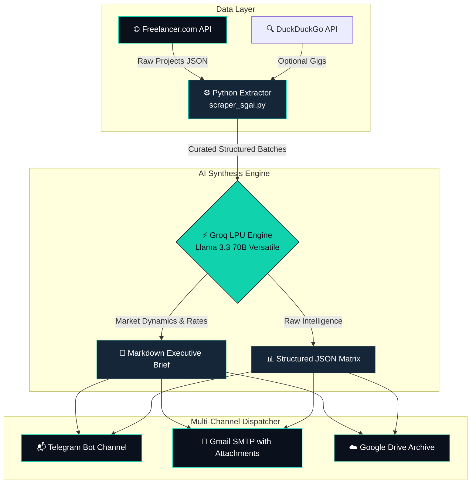

<div align="center">


# ⚡ FreeLanceScrapper

[](https://github.com/floydiamarkv-byte/FreeLanceScrapper/actions/workflows/ci.yml)
[](LICENSE)
### **Autonomous AI-Powered Market Intelligence & Gig Positioning Pipeline**

[](https://floydia.site)
[](https://python.org)
[](https://groq.com)
[](https://proxmox.com)
[](LICENSE)

<br/>

> **"Stop bidding blind. Let deterministic scraping and real-time LLM intelligence pinpoint where the highest margins and lowest competition are, every single morning."**

[🚀 Quick Start](#-quick-start) • [🏛️ Architecture](#-architecture--flow) • [📊 Niches Monitored](#-10-technical-niches-monitored) • [📋 Sample Output](#-executive-output-sample) • [🤝 Support](#-author--support)

</div>

---

## 📌 Overview

**FreeLanceScrapper** is an autonomous market intelligence agent designed for software engineers, IT architects, and tech agencies who want an unfair competitive advantage on global freelance platforms.

Instead of spending hours manually browsing listings or undercharging on proposals, FreeLanceScrapper operates as a **24/7 background intelligence officer**:
1. **Pulls Live Market Data**: Scrapes 140+ active projects daily directly from the Freelancer.com API across 10 high-value technical niches.
2. **Runs Deep Strategic Synthesis**: Feeds unstructured client requirements into **Groq's ultralow-latency Llama 3.3 70B Versatile LLM** to quantify pricing tiers, skill scarcity, and proposal win-probability.
3. **Dispatches Multi-Channel Intelligence**: Formats clean executive briefs and structured JSON, dispatching them automatically via Telegram, Email, and Google Drive before your workday starts.

---

## 🏗️ Architecture & Flow



---

## 📊 10 Technical Niches Monitored

| # | Niche | Focus & Scraped Parameters |
|---|-------|---------------------------|
| 1 | **Proxmox VPS / Homelab** | Enterprise virtualization, LXC/KVM, clustering & backup storage |
| 2 | **Home Assistant & IoT** | Zigbee/Z-Wave, MQTT brokers, dashboard design & automations |
| 3 | **WordPress & Elementor** | Flexbox containers, speed optimization, custom PHP & landing pages |
| 4 | **Python Automation** | Web scrapers, cron automation, API integrations & data parsers |
| 5 | **Local AI & LLM Servers** | Ollama, vLLM, private OpenAI-compatible API gateways |
| 6 | **MikroTik & Network Firewalls** | WireGuard VPN, VLAN segregation, BGP routing, security audits |
| 7 | **CCTV & Security Systems** | Hikvision, Dahua, RTSP streams, NVR remote integrations |
| 8 | **Embedded IoT Firmware** | ESP32, Arduino, sensor telemetry & low-power communications |
| 9 | **Technical SEO & Growth** | Schema markup, Core Web Vitals, conversion tracking |
| 10 | **DevOps & Docker CI/CD** | GitHub Actions, container orchestration, reverse proxies |

---

## 🚀 Quick Start

### 1. Clone & Install
```bash
git clone https://github.com/floydiamarkv-byte/FreeLanceScrapper.git
cd FreeLanceScrapper
python3 -m venv .venv
source .venv/bin/activate
pip install -r requirements.txt
```

### 2. Configure Environment
```bash
cp .env.example .env
```

Fill in your API keys in `.env`:
```env
# Required: Groq AI Engine (Free tier available at console.groq.com)
GROQ_API_KEY=gsk_your_groq_api_key_here

# Optional: Telegram Notifications
TELEGRAM_BOT_TOKEN=your_bot_token_from_botfather
TELEGRAM_CHAT_ID=your_telegram_chat_id

# Optional: Email SMTP Reports
EMAIL_SENDER=your_email@gmail.com
EMAIL_APP_PASSWORD=your_gmail_app_password
EMAIL_RECIPIENT=destination@email.com
```

### 3. Run Extraction
```bash
python scraper_sgai.py
```

### 4. Set Daily Cron (Zero Maintenance)
```bash
# Run automatically every morning at 7:00 AM
0 7 * * * cd /path/to/FreeLanceScrapper && /path/to/.venv/bin/python scraper_sgai.py >> scraper.log 2>&1
```

---

## 📋 Executive Output Sample

Every generated report provides immediate actionable clarity:

```markdown
# 📈 Freelance Market Intelligence — Daily Brief

### 🎯 Key Strategic Findings:
- **Top Paying Niche Today**: Local AI Server Setups ($450 - $1,200/proj)
- **Fastest Proposal Turnaround**: MikroTik WireGuard Deployments (<12h close)
- **High-Demand Scarcity Skills**: vLLM Optimization, Home Assistant Lovelace UI, Custom Crawl4AI scrapers.

### 💡 Suggested Positioning Strategy:
> "Target Proxmox + Docker hybrid setups. Clients are struggling with hardware passthrough and GPU allocation for private Ollama nodes. Emphasize turnkey delivery."
```

---

## 👤 Author & Support

Crafted with precision by **[Floydia](https://floydia.site)** — Led by **Eliú Hurtado** (+25 years in IT infrastructure, network security, and applied AI systems).

* 🌐 **Website**: [https://floydia.site](https://floydia.site)
* 💼 **LinkedIn**: [Eliú Hurtado](https://linkedin.com/in/eliutec)
* 🐛 **Issues & Feedback**: [Open a GitHub Issue](https://github.com/floydiamarkv-byte/FreeLanceScrapper/issues)

---

<div align="center">

Distributed under the [MIT License](LICENSE) • **Desde la infraestructura, todo.**

</div>
